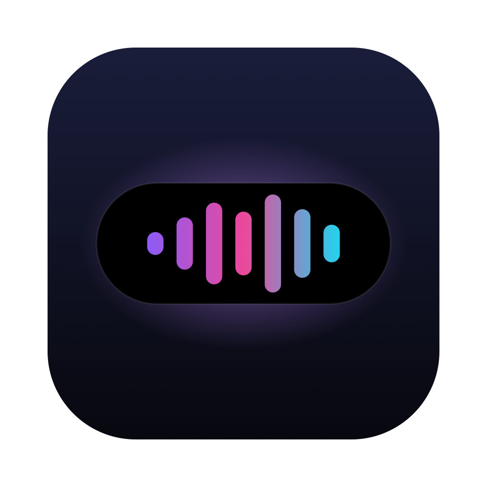

<p align="center"></p>

# SOFIA

A voice assistant that lives in the notch of your Mac. Give her any name you like and pick her voice at setup, then say "Hey <her name>", ask for something, and she does it on the Mac: opens apps and sites, moves windows, plays music, types for you, changes settings. Message her from your phone and she sends you a file from the laptop, a screenshot, or tells you whether it is still on.

Everything runs on your Mac. The model is a local open model through Ollama. Speech recognition is Apple's on-device engine. Her voice is one of six natural voices (four women, two men) generated on the Mac by [Kokoro](https://huggingface.co/hexgrad/Kokoro-82M) through [sherpa-onnx](https://github.com/k2-fsa/sherpa-onnx), both Apache-2.0. Nothing leaves the machine except your own Telegram bot and, only if you add keys, ElevenLabs or a cloud model for messages from your phone.

## Install

You need a Mac on macOS 13 or later, Apple silicon or Intel (the app is universal). 16 GB of memory runs the default model comfortably; Apple silicon answers faster.

### Option 1: one line in Terminal

```bash
curl -fsSL https://raw.githubusercontent.com/Sanjailenin/Sofia-OS/main/install.sh | bash
```

The script does, in order: uses Ollama if you already have it, or downloads the official Ollama app from ollama.com and starts it (no Homebrew, no password), pulls a model sized to your Mac's memory (about 5 GB for 16 GB Macs, 9 GB for 32 GB), downloads her voices and the wake-word model once (about 380 MB, checked against pinned SHA-256 sums, kept in `~/Library/Application Support/Sofia/Voices`), downloads the latest Sofia release, checks its SHA-256 against the published checksum, puts `Sofia.app` in `/Applications` (or `~/Applications` if you are not an administrator), and opens it. Read the script first if you like: it is short and plain bash.

Pick a different model with `SOFIA_MODEL=qwen3:14b` in front of the command. Remove everything later with:

```bash
curl -fsSL https://raw.githubusercontent.com/Sanjailenin/Sofia-OS/main/install.sh | bash -s -- --uninstall
```

### Option 2: download the app yourself

1. Install Ollama from [ollama.com](https://ollama.com) or `brew install ollama`, start it, and run `ollama pull qwen3:8b`.
2. Download `Sofia.zip` from the [latest release](https://github.com/Sanjailenin/Sofia-OS/releases/latest), unzip it, and move `Sofia.app` to Applications.
3. The app is not notarized yet, so the first time right-click it, choose Open, and confirm.
4. Add her voices and the wake-word model (about 380 MB, once); until then she uses the Mac's own voice and Apple's speech recognition only:

```bash
curl -fsSL https://raw.githubusercontent.com/Sanjailenin/Sofia-OS/main/install.sh | bash -s -- --voices
```

### Option 3: build from source

```bash
git clone https://github.com/Sanjailenin/Sofia-OS && cd Sofia-OS
scripts/test.sh
scripts/build-app.sh && open build/Sofia.app
```

Needs the Xcode Command Line Tools (`xcode-select --install`), nothing else.

### First run

A welcome window asks two things: **her name** (the default is Sofia; whatever you choose becomes the wake phrase, "Hey <name>") and **her voice**: Heart, Kore, Sarah or Aoede (women), Puck or Fenrir (men), with a Preview button. These six scored best of 32 voices tested for naturalness and clarity. Both can be changed later in Settings. The same window lists every permission she uses, each with an Allow button, and an **Allow everything** button that asks macOS for them one after another; Accessibility and Screen Recording open System Settings, where you switch Sofia on. Anything you skip can be allowed later in Settings → Permissions, which also has a Reset button for an entry left over from an older version.

| Permission | Why | Needed for |
|---|---|---|
| Microphone | hearing you | everything by voice |
| Speech Recognition | on-device transcription | the wake word, requests, dictation |
| Accessibility | moving windows, pressing controls, typing | Mac control, dictation |
| Screen Recording | screenshots | the `screen` command from your phone, screen tasks |
| Calendars | today's events | staying quiet during meetings, the battery nudge before one |
| Automation (System Events, and Spotify or Music the first time each is used) | music control, dark mode, typing | Mac control |

Say "Hey <her name>" or press ⌃⌥S and ask for something. If she says the model is not reachable, run `ollama serve` in Terminal or check the model name in Settings.

## Use

- "Hey <her name>, …" or ⌃⌥S to talk. Esc cancels. She keeps listening for a follow-up after answering; "thanks" or "that's all" closes.
- ⌃⌥D dictates: speak, and she types it where your cursor is. Press again to stop early.
- "<Her name>, go off" puts her to sleep, any time, no "Hey" needed. "Turn off", "shut down", "go to sleep" and "good night" work too. "Hey <her name>", a double clap, the hotkey or the menu bar item wake her.
- Two listeners hear "Hey <her name>": Apple's on-device speech recognition, and a small keyword spotter ([sherpa-onnx](https://github.com/k2-fsa/sherpa-onnx), a 3 MB streaming Zipformer) that listens for the sound of the phrase instead of reading a transcript, so a name the recogniser writes wrong still wakes her. Whichever hears it first wins. It works for any name made of letters; on test voices it caught about 70% of wakes (Max 89%, Nova 79%, Sofia and Luna 75%, Jarvis 71%, Maya 67%) and fired on nothing in 14 minutes of other speech. It can be switched off in Settings.
- A double clap is checked by macOS's built-in sound classifier before it counts: two bangs that sound like a knock, a door, a finger snap, typing or a glass are ignored, and the events log says so. Close calls still count.
- While the Mac plays any audio (music, a video, a call), claps and the entrance phrase are ignored and only "Hey <her name>" wakes her. Claps are also ignored while you type or click and while the screen is locked.
- The island follows your pointer across displays; on a screen without a notch it is a pill under the menu bar.
- Nudges: low battery (earlier when a meeting is coming), disk nearly full, network lost and back.
- Replies are spoken sentence by sentence as the model writes them, and the model answers without a thinking phase by default; turn "Let the model think" on in Settings if you want slower, more careful answers.
- Optional entrance: a Spotify track or your own audio file on a double clap or "wake up, daddy's home". Off by default. Spotify pauses when the track ends, and quits again if the entrance started it.

For anything no single action covers ("fill in this form", "find the invoice in Mail and download it") she can use the screen, mouse and keyboard step by step with a vision-capable local model (Settings → vision model, default `qwen3-vl:8b`, pull it with `ollama pull qwen3-vl:8b`; the model must support both vision and tools, which `qwen2.5vl` and `gemma3` do not). Requests like "click the subscribe button", "scroll down", "skip the ad" or "what's on my screen" go straight to this. She prefers real controls from the accessibility tree over pixel clicks, never logs in, pays or deletes unless asked, and never touches a password manager. Switch it off in Settings if you prefer.

Things she can do on the Mac, from a fixed list that is checked before anything runs: open, quit and switch apps; open https links and files; volume, mute, dark mode, Wi-Fi, lock screen, screenshot; type text; search the web; find files; play music; open System Settings pages; copy to the clipboard; make a note; open app links such as `spotify:`; move windows left, right, full, centre or to another display; hide and show apps; Focus on and off through two Shortcuts you create ("Sofia Focus On" and "Sofia Focus Off", each with a Set Focus action); change her own settings. Programs and scripts are never opened, and nothing from a model is ever run as a shell command.

## From your phone

1. In Telegram, message @BotFather, send `/newbot`, and copy the token it gives you.
2. In Sofia's Settings, under "From your phone", paste the token and press Return.
3. Settings shows a six-digit code. Send it to your bot from your phone. Only that chat is ever answered.

These commands never touch a model:

| Message | What happens |
|---|---|
| `status` | whether the Mac is on, battery, what is in front, free disk |
| `screen` | a screenshot |
| `send me <name or words>` | the file, from your allowed folders |
| `find <words>` | a list of matching files |
| `download https://…` | saves the link to Downloads |
| `lock`, `open Safari`, `quit Slack`, `volume 30`, `mute`, `play`, `next` | the obvious |
| `stop remote` / `start remote` | remote access off and on |
| `help` | this list |

Anything else goes to the model. By default that is the same local Ollama model. In Settings you can point free-form messages from the phone at OpenAI with your own key, while everything said at the Mac stays local.

Files leave the Mac only from the folders you allow (Desktop, Documents, Downloads, Movies, Pictures and Music by default). Hidden files, Library, SSH keys, keychains, env files and anything that looks like a key are refused, as is anything over 100 MB. A closed lid still sleeps the Mac unless a display is attached; "Keep this Mac awake while plugged in" holds it awake on mains power.

## Troubleshooting

- **"Ollama isn't running"**: open the Ollama app (or run `ollama serve` in Terminal), then `ollama pull <model>`. Check the model name in Settings matches `ollama list`.
- **She does not hear her name**: short names with clear vowels work best; the wake listener also accepts common misspellings of the name you chose. Speech Recognition and Microphone must be allowed for Sofia; the wake word needs an on-device English model, which macOS downloads under System Settings → General → Language & Region. Check the menu bar icon is not the slashed one (standby).
- **Nothing happens on the Mac when she says she did it**: Accessibility is off for Sofia. System Settings → Privacy & Security → Accessibility.
- **Telegram does not answer**: the token was saved without pressing Return, or the chat is not paired. Unpair and send the new code.
- **"Wake with Hey <her name>" won't stay on?** macOS hasn't allowed speech recognition or the microphone for Sofia. Settings shows the reason under the switch with steps and a button to the right pane. In short: System Settings → Privacy & Security → Speech Recognition (and Microphone) → turn Sofia on; if Sofia isn't listed, quit and reopen it and click Allow. After an update macOS can treat Sofia as a new app, so turn its entry off and on again. Then flip the switch on.
- **What woke her?** `~/Library/Logs/Sofia/events.log` lists every trigger with the app that was in front. It never contains what you said.

## Privacy and safety

See [PRIVACY.md](PRIVACY.md) and [SECURITY.md](SECURITY.md). In short: local model, on-device speech, no telemetry, no update server, keys in your Keychain, a double-checked action list, a strict file policy, and a trigger log that records what woke her without ever storing transcripts.

## License

MIT. Downloaded at install time, under their own Apache-2.0 licences: [sherpa-onnx](https://github.com/k2-fsa/sherpa-onnx), the Kokoro voices and the kws-zipformer-gigaspeech-3.3M keyword model. The tests include that keyword model's token list.
